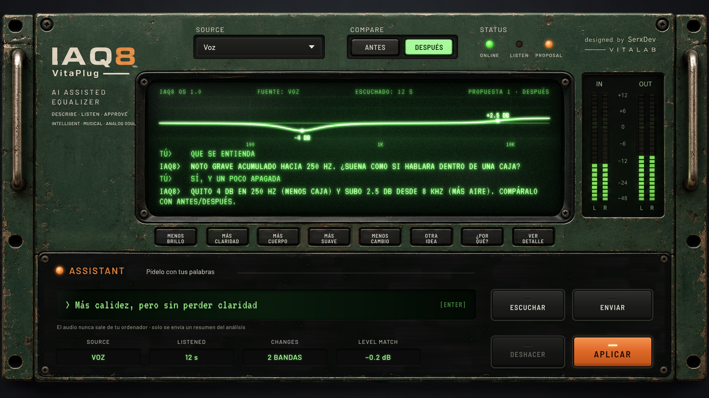
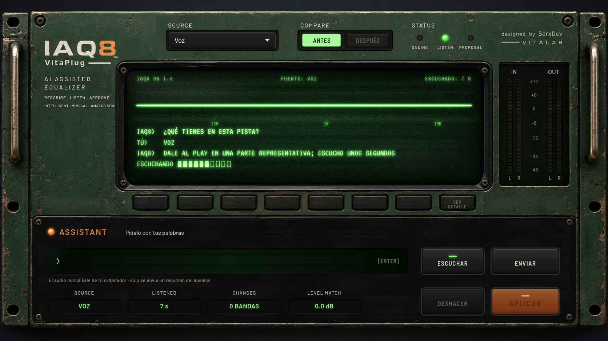
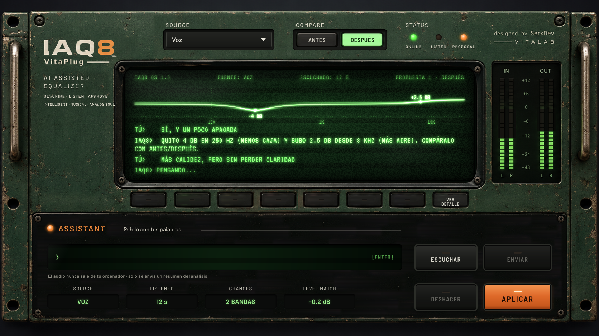
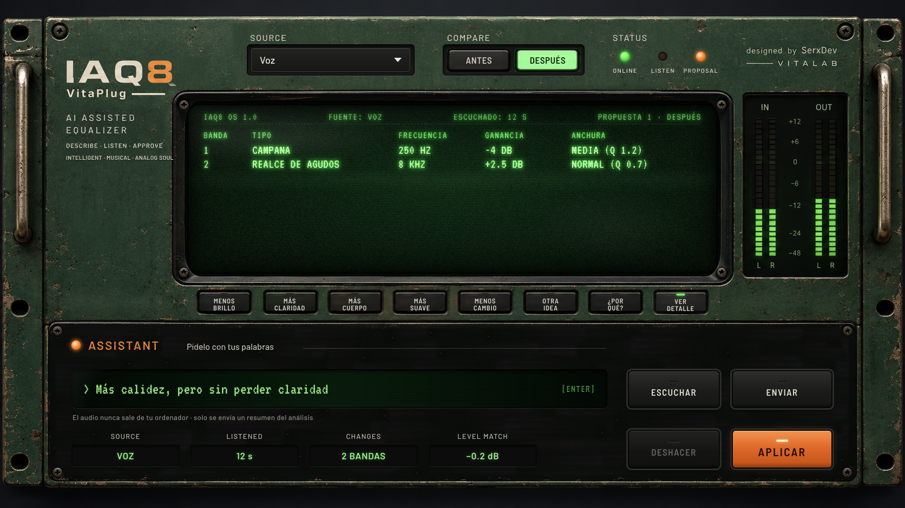

# IAQ8

Plugin asistente de ecualización mediante IA usando modelos de Claude. El asistente
analiza el audio según los prompts del usuario, propone soluciones y las aplica siempre
tras la aprobación del mismo. Basado en el DSP de LABQ8 de VitaPlug.



> **Estado:** prototipo funcional en macOS (AU probado en Logic Pro 13). Uso local,
> todavía sin distribuir. Este documento resume todo lo hecho hasta ahora.

---

## Qué es

IAQ8 es un **ecualizador para no profesionales**: para quien no sabe de audio ni maneja
ecualizadores, pero quiere que su pista suene mejor.

1. IAQ8 pregunta **qué hay en la pista** (voz, guitarra acústica, guitarra eléctrica,
   bajo, batería, mezcla completa u otro).
2. **Escucha** unos segundos de la pista mientras suena y mide cómo es.
3. Pregunta **qué quieres conseguir**. Se contesta con las teclas rápidas
   ("menos caja", "más claridad"…) o escribiendo con tus palabras.
4. La IA **propone** un ajuste y explica en lenguaje llano qué hace y por qué.
5. Comparas **ANTES / DESPUÉS** con el volumen igualado, para que "más alto" no parezca
   "mejor".
6. Pides cambios conversando ("un poco menos", "¿por qué?", "otra idea"…).
7. **Solo cuando lo apruebas** pulsas APLICAR. DESHACER vuelve atrás.

El audio **nunca sale del ordenador**: al servidor solo se envía un resumen numérico
del análisis y la conversación.

Por dentro suena igual que LABQ8: usa el mismo motor DSP y los mismos parámetros. Es el
primero de una serie de plugins VitaPlug asistidos por IA, uno por cada plugin de la
marca. Como concepto, sustituye a la sección INTENTION de LABQ8.

---

## Cómo está hecho

```
┌──────────────── Plugin IAQ8 (JUCE, C++20) ────────────────┐        ┌──── Servidor VitaPlug ────┐
│  Audio ─► motor EQ (DSP de LABQ8)                          │        │  TypeScript               │
│           ├─ EQ aplicada                                   │        │  (Cloudflare Workers + D1 │
│           └─ EQ propuesta (previsualización, A/B, volumen  │ HTTPS  │   o en local)             │
│              igualado)                                     │ ◄────► │  códigos de acceso,       │
│  Captura ─► analizador ─► resumen numérico (sin audio)     │  JSON  │  límites, coste,          │
│  Sesión de conversación ─► límites de seguridad            │        │  prompt ─► Claude         │
│  Interfaz: rack digital años 80, pantalla de fósforo       │        └───────────────────────────┘
└────────────────────────────────────────────────────────────┘
```

### El plugin

- **Motor de audio:** dos EQ en paralelo (la aplicada y la propuesta) con fundido de
  20 ms al cambiar ANTES/DESPUÉS, e igualación de volumen K-weighted (±6 dB) solo
  en la previsualización. Sin bloqueos en el hilo de audio.
- **Captura y análisis:** guarda la señal útil (ignora silencios), mide el espectro
  (Welch) frente a una tendencia suave y detecta candidatos: exceso, falta, resonancias,
  retumbe grave y sibilancia. El resultado es un JSON pequeño, sin audio.
- **Cliente HTTPS** cancelable, con vigilancia de tiempo y un validador JSON estricto
  antes de interpretar ninguna respuesta.
- **Límites de seguridad** sobre cualquier propuesta, venga de donde venga: máximo
  5 bandas, ganancia entre −12 y +6 dB, Q acotada por tipo de filtro y un limitador de
  la respuesta combinada.
- **Sesión:** primeras preguntas locales, escucha, análisis en segundo plano,
  conversación y el estado guardado con el proyecto (sin propuestas a medias tras
  recargar).
- **Interfaz** basada en LABQ8: rack digital de los 80 con aspecto gastado,
  pantalla CRT de fósforo verde (brillo, líneas de barrido, viñeta y reflejo), curva de
  la EQ, conversación, ocho teclas, panel ASSISTANT con línea de comando, casillas
  SOURCE / LISTENED / CHANGES / LEVEL MATCH, pilotos ONLINE / LISTEN / PROPOSAL,
  medidores IN/OUT reales y seis tamaños de zoom (40 % a 140 %). Fuentes VT323 y
  Barlow (licencia SIL OFL).

| Escuchando | Pensando | Detalle de la propuesta |
|---|---|---|
|  |  |  |

### El servidor

- Contrato validado en las dos direcciones; peticiones de 256 KB y análisis de 16 KB como máximo.
- **Códigos de acceso** guardados solo como hash, con límites por código: 30 sesiones y
  400 turnos al mes, 10 peticiones por minuto y un tope de gasto mensual.
- Modelo por defecto **Claude Sonnet 5.5** con salida estructurada (JSON Schema),
  caché del prompt, sin reintentos ocultos y coste calculado en cada turno.
- La conversación se recorta (últimos 190 mensajes) y el análisis se reinyecta en
  cada turno.
- Registro de fallos sin datos sensibles.
- **Uso local con doble clic:** un lanzador pide la clave de Claude una vez (se guarda
  solo en ese Mac), prepara la base de datos, configura el plugin y arranca el servidor.

### Batería de evaluación

Casos sintéticos y con loops reales, "estropeados" a propósito (barro, dureza, falta de
brillo, retumbe, sibilancia). La batería comprueba que la propuesta corrige el daño,
actúa en la zona correcta y no toca lo que está bien. Incluye correcciones encadenadas,
repeticiones, la cota de coste y un informe HTML. La herramienta `iaq8_render` genera el
antes/después de un archivo para escucharlo.

---

## Cómo se hizo

El proyecto se diseñó y programó con Claude (Claude Code), en tres planes. Cada tarea la
implementó un agente y la revisó otro antes de seguir, y cada plan terminó con una
revisión completa y una tanda de arreglos.

| Plan | Qué | Resultado |
|---|---|---|
| Diseño | Especificación, decisiones de producto y maqueta visual aprobada | Documento de diseño y maqueta |
| 1 · Núcleo del plugin | Motor A/B, igualación de volumen, captura, analizador, cliente, límites y sesión | 10 tareas + revisión final |
| 2 · Servidor | Contrato, accesos, límites, prompt, modelo, batería de evaluación, despliegue, `iaq8_render`, prueba de extremo a extremo | 7 tareas + revisión final |
| 3 · Interfaz | Rack, pantalla de fósforo, teclas, panel, fila superior, vínculo con la sesión, instantáneas | 8 tareas + revisión final |

**Pruebas:** 161 del plugin (y 3 opcionales de red) y 183 del servidor, todas en verde.

**Comprobado en real:**
- Logic Pro 13 en macOS 26.5: la red funciona desde el plugin y la validación AU (`auval`) pasa.
- La conversación completa con la clave real en local.
- La interfaz en Logic.

**Decisiones registradas:** cada plan dejó por escrito las decisiones tomadas por el
camino y lo que queda pendiente.

---

## Qué falta

- Terminar la lista de pruebas de la interfaz en Logic: teclado, menú contextual,
  automatización y memoria en Retina a 140 %.
- Probar en un host VST3.
- Pasar la batería con grabaciones reales de estudio y medir el coste real por sesión.
- Ajustar el analizador: aún no detecta bien un realce ancho de graves en el bajo.
- Pequeñas mejoras de la interfaz, por ejemplo ANTES apagada cuando no hay propuesta y
  dividir el archivo principal del editor.
- EQ dinámica, como primera ampliación (sibilancia y dureza intermitente).
- Si se distribuye: servidor en Cloudflare, cuentas, licencias y Windows.

---

## Código

El código no es público por ahora:
- el plugin vive dentro del repositorio privado de LABQ8, porque comparte su DSP;
- el servidor está en un repositorio local aparte.

Este repositorio documenta el proyecto.

© VitaPlug · diseño de SerxDev
